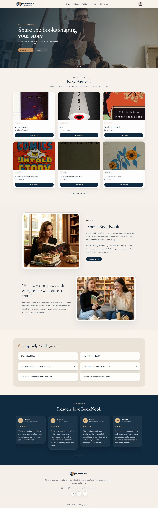

## ✨ Project Overview



# BookNook 📚

A modern full-stack library and book-sharing platform designed for passionate readers to explore curated collections, share recommendations, borrow titles, and manage their personal literary shelves effortlessly.

## Live Link: https://assignment-8-ovi-web.vercel.app/

---

## 🚀 Technologies Used

- **React / Next.js:** For modular component architecture, fast routing, and seamless client-server rendering.
- **Tailwind CSS:** For styling a clean, editorial aesthetic with responsive layouts across mobile, tablet, and desktop screens.
- **Node.js & Express:** For building secure RESTful API endpoints handling books, categories, and borrowing records.
- **MongoDB:** For flexible and scalable document-based storage of books, user collections, and inventory counts.
- **Firebase / NextAuth (OAuth 2.0):** For seamless authentication with Google Sign-In and email/password registration.
- **React Toastify / SweetAlert2:** For immediate, interactive alerts and action confirmations.

---

## ✨ 5 Key Features

1. **Curated Book Catalog & Categorization**  
   Explore a rich collection of books categorized by genres, complete with cover art, author details, synopsis, ratings, and copy availability.

2. **Real-time Book Borrowing & Return System**  
   Borrow available books instantly with automatic inventory count adjustments and borrow-record tracking linked to the user's account.

3. **User Dashboard & Shelf Management ("My Books" & "My Borrows")**  
   Dedicated member sections to track currently borrowed books, review borrowing history, and manage submitted titles.

4. **Multi-Method Secure Authentication**  
   Flexible authentication supporting direct Google Sign-In and standard email/password registration with structured post-signup redirect flows.

5. **Community Contributions (Add & Update Books)**  
   Allows authenticated members to add new books to the global library with custom covers, copy quantities, and metadata.

---

## 💻 Getting Started Locally

To run this project on your local machine, follow these steps:

### 1. First Clone the Repository
```bash
git clone https://github.com/Ovi-web/assignment-8.git
cd assignment-8
```

### 2. Install Dependencies
Make sure you have Node.js installed, then run:
```bash
npm install
# or
yarn install
# or
pnpm install
```

### 3. Environment Variables Setup
Create a `.env.local` file in the root directory and configure the required keys:
```env
NEXT_PUBLIC_API_URL=your_backend_server_url
NEXT_PUBLIC_FIREBASE_API_KEY=your_firebase_key
# or NextAuth configuration
NEXTAUTH_URL=http://localhost:3000
NEXTAUTH_SECRET=your_secret_key
GOOGLE_CLIENT_ID=your_google_client_id
GOOGLE_CLIENT_SECRET=your_google_client_secret
```

### 4. Run the Development Server
Start the local development server:
```bash
npm run dev
# or
yarn dev
# or
pnpm dev
```

### 5. Open in Browser
Open [http://localhost:3000](http://localhost:3000) with your browser to see the application running.
